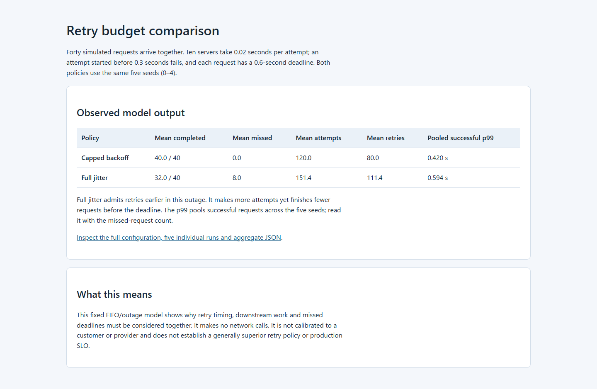

# Retry Budget Lab

Compare retry work, completed requests and successful-request latency before
choosing a client retry policy. This local Python simulation sends a synthetic
burst through a finite-capacity FIFO service with an outage and a deadline.
It makes no network calls and does not sleep.

[](https://github.com/skyon0522-ai/retry-budget-lab/actions/workflows/ci.yml)

## Try the comparison



The included scenario has 40 requests arriving together, 10 servers, a
0.3-second outage and a 0.6-second deadline. It runs capped exponential
backoff and full jitter with the same five seeds (`0,1,2,3,4`). Python 3.10 or
later is required; no packages, account or external service are needed. From
the repository root:

```sh
python demo.py --output-dir demo-output
```

Open `demo-output/report.html` locally. The command also saves the complete
`report.json` with configuration, each seeded run and aggregates. It refuses an
existing output directory. You can inspect the committed [offline HTML](examples/reports/report.html)
and [JSON](examples/reports/report.json) without running Python.

| Policy | Mean completed / 40 | Mean misses | Mean attempts | Mean retries | Pooled successful p99 |
| --- | ---: | ---: | ---: | ---: | ---: |
| Capped backoff | 40.0 | 0.0 | 120.0 | 80.0 | 0.420 s |
| Full jitter | 32.0 | 8.0 | 151.4 | 111.4 | 0.594 s |

These are observed model outputs averaged across five seeded runs; p99 pools
**only successful** request latencies. In this fixed outage, full jitter admits
retries earlier, makes more attempts, yet finishes fewer requests before the
deadline. This is a counterexample to judging a retry policy by timing or
latency alone. It does not show that capped backoff is better in general.

## Read and adapt the experiment

| Start here | Purpose |
| --- | --- |
| [demo.py](demo.py) | Fixed comparison, offline HTML and JSON exports |
| [retry_budget_lab.py](retry_budget_lab.py) | Configuration, event loop, aggregation and command-line interface |
| [METHODOLOGY.md](METHODOLOGY.md) | Event ordering, metric definitions and limits |
| [tests](tests/) | Exact behavior, accounting and example-output checks |
| [Other recorded scenarios](examples/) | Default and shared-budget outputs as well as this short-deadline result |

The demo calls the same `experiment()` function as the CLI. To run another
configuration with the same seeds, use:

```sh
python -m retry_budget_lab --clients 40 --base-seconds 0.1 --deadline-seconds 0.6 --seeds 0,1,2,3,4 --output short-deadline-results.json
python -m retry_budget_lab --retry-budget 50 --output budget-50-results.json
```

The CLI can replace an existing `--output` file; use a new filename when
comparing runs. Each JSON file retains the settings and seeds. Run
`python -m retry_budget_lab --help` for every parameter. Optional installation
adds the `retry-budget-lab` command via `python -m pip install .`.

The [default case](examples/default.json) completes 200/200 requests under
both policies. The [shared-cap case](examples/budget-50.json) admits fewer
retries but leaves 100/200 requests unsuccessful under both policies. Its
lower successful p99 must be read with those misses. The short-deadline case
above makes the timing tradeoff visible. The model never changes a deployed
client or service.

## What the numbers mean

All requests arrive at time zero. Each attempt occupies one server for a
fixed duration; attempts started during the outage fail after using that
capacity. Excess attempts wait in a FIFO queue. An end-to-end deadline covers
backoff, queueing and service. A completion exactly at the deadline misses.
Running work can continue after its caller expires.

`attempts` counts first attempts and admitted retries; `retry_attempts` counts
only retries. The optional `retry_budget` is a fixed, run-wide admission cap,
not an adaptive token bucket. Capped backoff waits for its capped exponential
window; full jitter draws a seeded delay between zero and that window. The
simulator records completed requests and all three miss reasons separately.
See [METHODOLOGY.md](METHODOLOGY.md) for the event path, accounting equations
and exact percentile definition.

This model uses one simultaneous burst, identical service times, constant
capacity, one outage and an unbounded waiting room. It does not model network
delay, changing arrivals, partial success, overlapping retries, provider
rate limits, token costs or real workload traces. No checked-in scenario was
calibrated to a customer or provider. Validate the assumptions with measured
traffic, downstream limits and idempotency requirements before making an
operational decision. The research context is in [references.bib](references.bib);
it does not validate these numerical results.

## Development

```sh
python -m unittest discover -s tests -v
python -m pip install ruff==0.16.10
ruff check .
ruff format --check .
```

The tests cover exact FIFO and deadline behavior, retry budgets, repeatability,
input rejection, conservation across 90 scenarios and the committed demo
outputs. The [CI workflow](.github/workflows/ci.yml) is configured for Python
3.10, 3.12 and 3.14; consult its run page for actual remote results. Local code
is [MIT-licensed](LICENSE).
